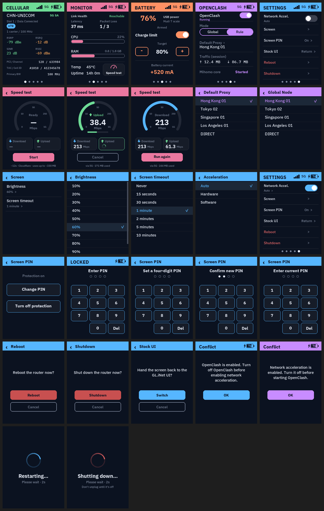
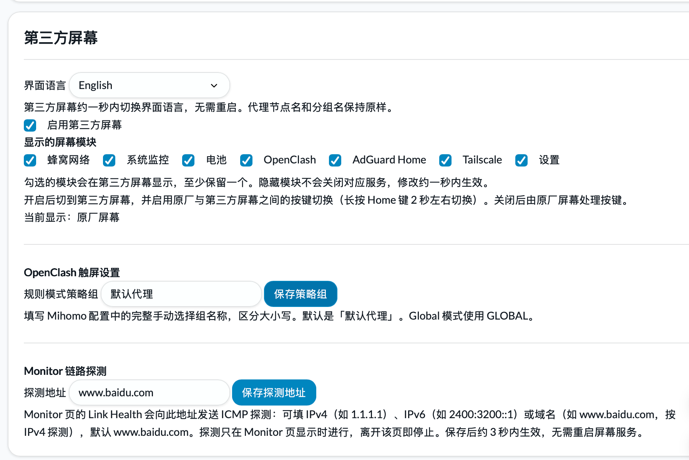
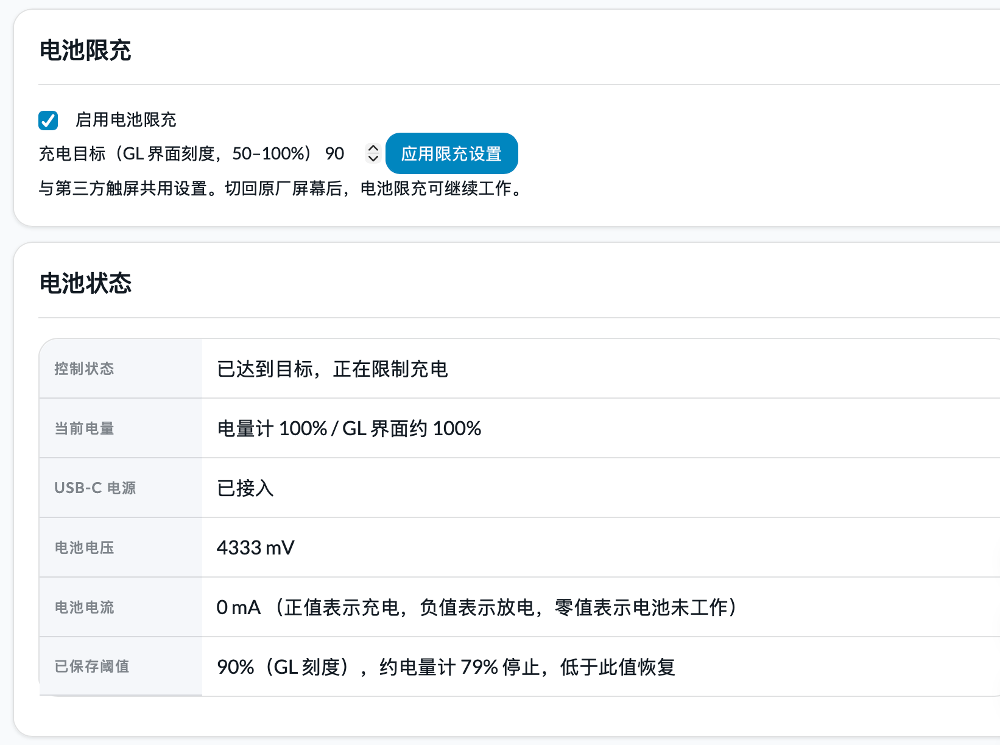
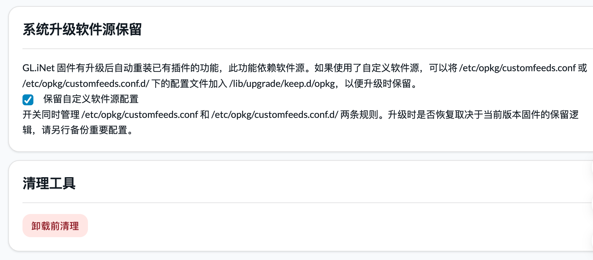

[English](./README_en.md)

# GL-E5800 Mudi7 个性化 IPK 插件

**写在前面：** 屏幕设计参考 [robavionix/gl-e5800-dashboard](https://github.com/robavionix/gl-e5800-dashboard) 项目，电池充电控制使用 quec-battery（基于 [quec-battery2](https://github.com/zhongfu/quec-battery2)），原厂屏幕汉化参考[Shad0w23333/glinet-mudi7-cn](https://github.com/Shad0w23333/glinet-mudi7-cn) 。感谢这些项目作者的开源与付出，为 Mudi7 注入活力！

本项目目的是补充 Mudi7 原厂屏幕没有的控制功能，解决一些日用痛点。原厂屏幕其实已经有了相当多的控制功能，因此本项目不会在第三方屏幕上新增冗余功能，这是与参考项目们最大的不同之处。

目前支持的最新固件版本为：4.10.4

## 亮点与功能

1. 保留原厂屏幕，可以随时在原厂屏幕与第三方屏幕之间切换（通过长按 Home 键 2 秒左右）。
2. 第三方屏幕同样支持设置锁屏密码。密码管理与原厂屏幕独立，可以与原厂屏幕相同或不同。
3. 第三方屏幕支持自定义亮度、屏幕超时休眠控制。
4. 加入了电池充电控制功能，可以设置充电阈值，能够在达到充电阈值后停止向电池充电，适合长时间插电使用，而无需因担心电池寿命卸下电池。LuCI 与第三方屏幕共用限充设置，充电进程会在下次采样时应用新阈值。
5. 支持对原厂界面进行汉化操作，汉化前按原厂语言资源匹配兼容性。汉化前会备份，可以还原；结构或字体映射不安全时拒绝应用。
6. 支持解锁GL管理后台在简体中文语言下隐藏的VPN等功能入口（谨慎使用该功能：请在符合当地相关法律法规的情况下合理使用，后果自负）。
7. 安装 `ipk` 及官方软件源中的 Python 依赖即可使用。充电进程切换时会备份原厂二进制，卸载前清理或卸载时会恢复原厂充电进程。
8. 自带一个LuCI管理页面，可在OpenWrt LuCI——系统——Mudi7 个性化中打开，具有启用/关闭第三方屏幕、设置电池充电限制、设置 Monitor 链路探测地址、设置系统升级软件源保留、卸载本插件的功能。

## 界面预览

### 第三方屏幕

以下为第三方屏幕的界面总览，使用示例数据展示各页面与操作状态。点击图片可查看原图。

### LuCI 管理页面

在 OpenWrt LuCI 的「系统 → Mudi7 个性化」中打开管理页面。

第三方屏幕开关、OpenClash 触屏设置与 Monitor 链路探测：

电池限充设置与电池状态：

系统升级软件源保留与卸载前清理：

## 注意事项
1. 锁屏密码的密码加密存在本地，但是由于只有四位数，仍能够在得到密文后被离线穷举破解。
2. 如果GL官方在未来新增电池充电控制功能，本项目的电池限充功能将会随之移除。
3. 系统更新可能会破坏本项目的功能。
4. OpenWrt一般会在系统升级后删除用户自己安装的插件，但是插件本身的数据还会保留。不过GL固件具有系统升级后自动重新安装插件的逻辑。因此，如果你想获得系统升级后仍能保留本插件及其数据的体验，请自行搭建软件源，并将本插件放置于你的软件源中。否则，每次升级系统后你必须手动重新下载并安装本插件。

## 声明
本项目不含任何专有文件，也不对设备任何原有功能做逆向、破解，仅利用设备已有接口对相关功能进行调整。使用前请对设备已有内容进行备份（包括但不限于系统固件、用户数据），风险自担，作者不承担任何责任。