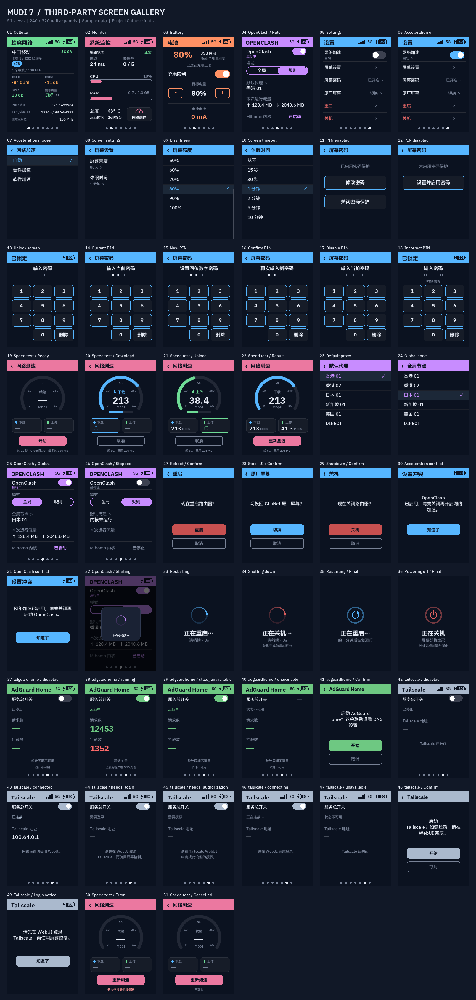
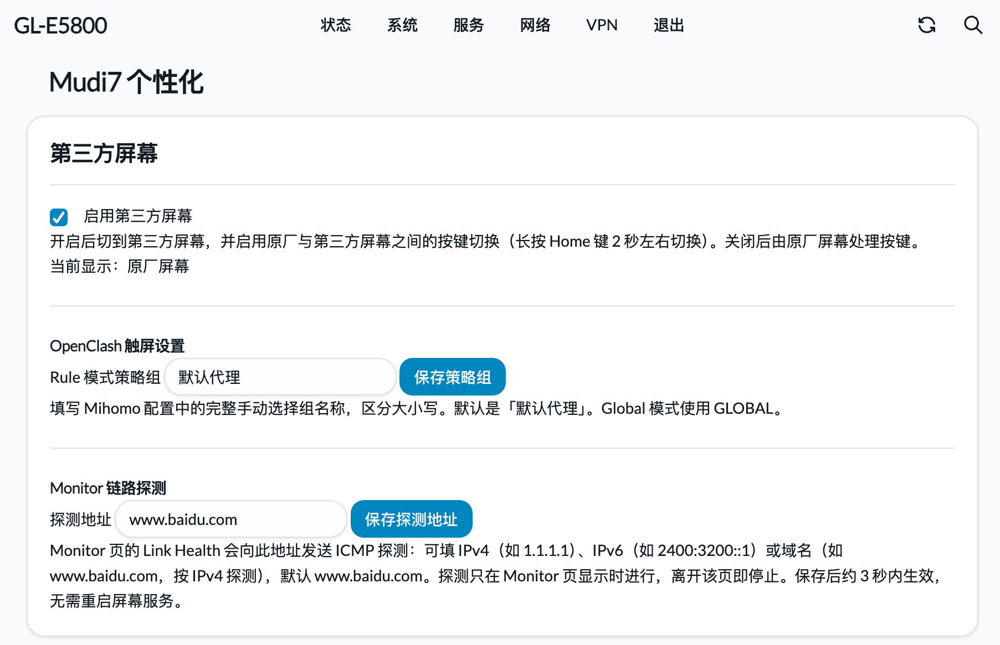
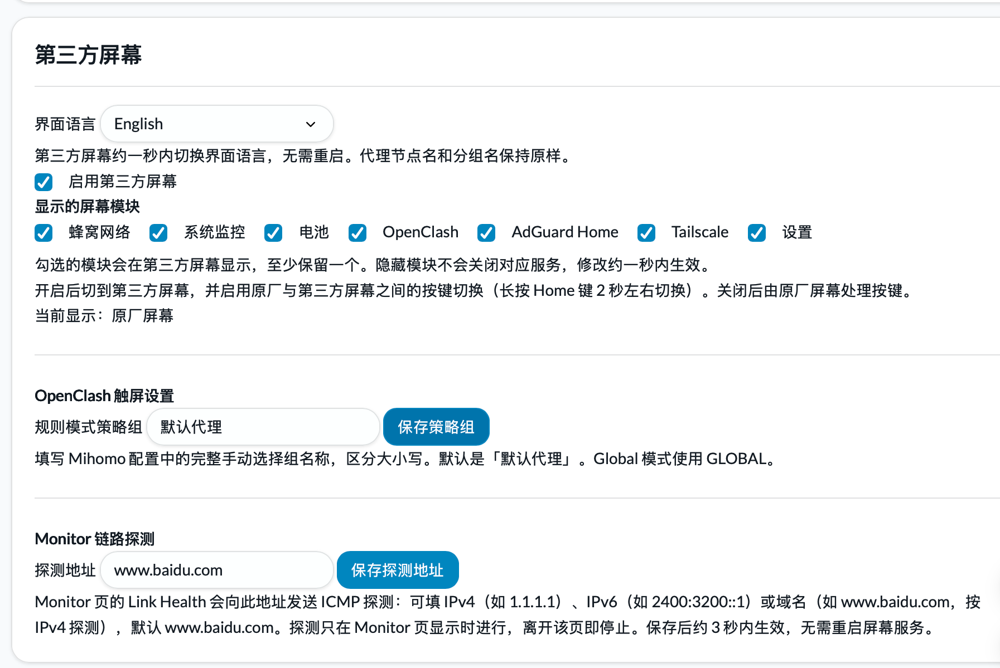
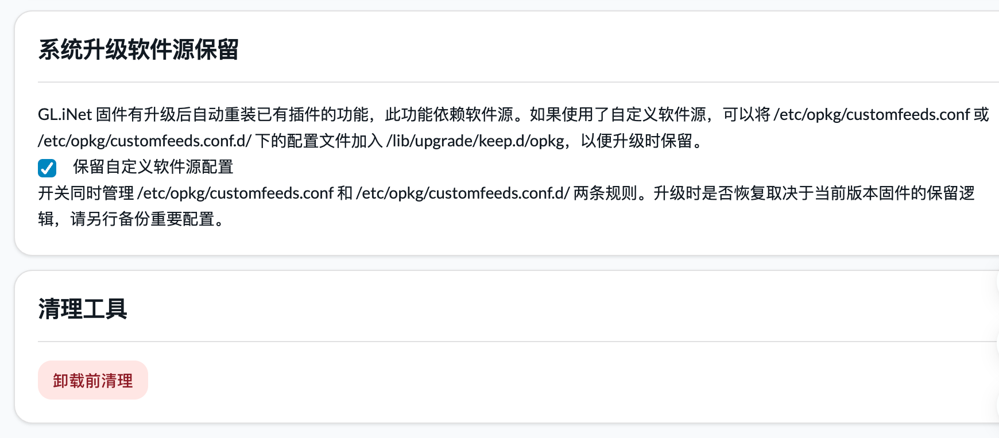

[简体中文](./README.md)

# GL-E5800 Mudi7 Customizer IPK

The dashboard design draws on [robavionix/gl-e5800-dashboard](https://github.com/robavionix/gl-e5800-dashboard), battery charge control on [ChiliApple/mudi7-battery-limit](https://github.com/ChiliApple/mudi7-battery-limit), and Chinese localization for the stock interface on [Shad0w23333/glinet-mudi7-cn](https://github.com/Shad0w23333/glinet-mudi7-cn). Thanks to the authors for sharing their work with the Mudi7 community!

This project adds controls missing from the Mudi7's stock touchscreen to address common day-to-day needs. Since the stock interface already offers many controls, the custom dashboard focuses on filling those gaps.

## Features

1. Keep the stock interface and switch between it and the custom dashboard anytime by holding the Home button for about two seconds.
2. Set a lock-screen PIN for the custom dashboard. The PIN is managed separately and can be the same as or different from the stock interface PIN.
3. Adjust the custom dashboard's brightness and screen timeout.
4. Set a battery charge limit. Charging stops when the battery reaches the configured threshold, so you can leave the Mudi7 plugged in for extended periods with the battery in place. The charge control implementation supports more chargers and improves daemon performance compared with the reference project.
5. Apply a Chinese translation to the stock interface. The plugin checks compatibility against the stock language resources and creates a backup you can restore. It blocks the translation if the resource structure or font mappings make it unsafe to apply.
6. Install the `ipk` and its Python dependencies, which are available from GL.iNet's official package feeds. Installation requires no manual patching of stock firmware files. After a firmware upgrade, reinstall the `ipk` to restore the plugin.
7. Open **System → Mudi7 Customizer** in OpenWrt LuCI to enable or disable the custom dashboard, set the battery charge limit, configure the Monitor link probe targets, preserve package feeds across firmware upgrades, or uninstall the plugin.

## Interface Preview

### Custom Dashboard

The overview uses sample data to show the dashboard pages and their various states. Click the image to view it at full size.

### LuCI Administration

Open **System → Mudi7 Customizer** in OpenWrt LuCI.

Custom dashboard toggle, OpenClash touchscreen settings, and Monitor link probes

Battery charge limit and battery status

Package feed preservation across firmware upgrades and pre-uninstall cleanup

## Notes

1. The lock-screen PIN is encrypted and stored locally. Anyone who obtains the encrypted value can brute-force the four-digit PIN offline.
2. If GL.iNet adds battery charge control to the stock firmware, this project's charge limit feature will be removed.
3. Firmware upgrades may break plugin functionality.
