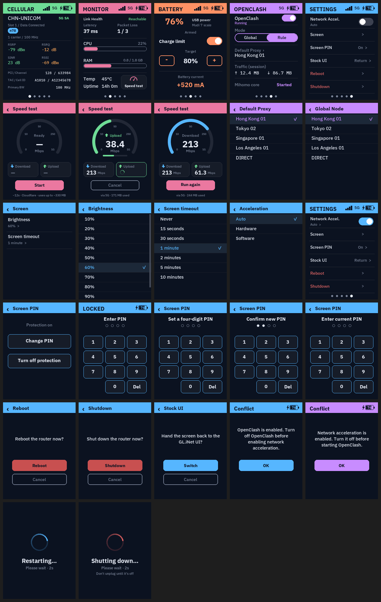
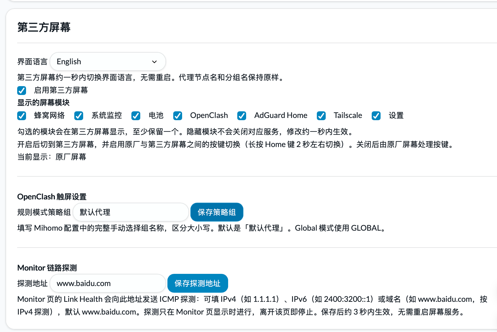
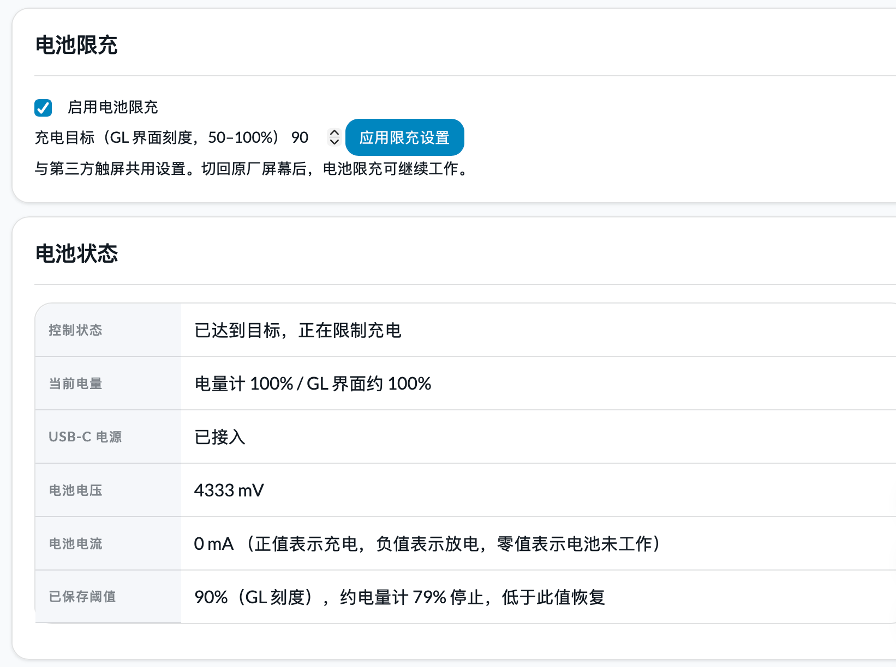
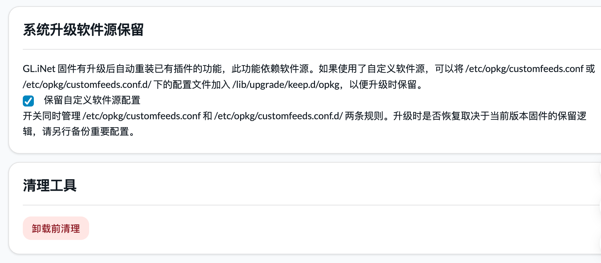

[简体中文](./README.md)

# GL-E5800 Mudi7 Customizer IPK

The dashboard design draws on [robavionix/gl-e5800-dashboard](https://github.com/robavionix/gl-e5800-dashboard), battery charge control on [ChiliApple/mudi7-battery-limit](https://github.com/ChiliApple/mudi7-battery-limit), and Chinese localization for the stock interface on [Shad0w23333/glinet-mudi7-cn](https://github.com/Shad0w23333/glinet-mudi7-cn). Thanks to the authors for sharing their work with the Mudi7 community!

This project adds controls missing from the Mudi7's stock touchscreen to address common day-to-day needs. The stock touchscreen already offers a wide range of controls, so this project's focus on filling specific gaps is its main difference from the projects above.

The latest supported firmware version is 4.10.4.

## Features

1. Keep the stock interface and switch between it and the custom dashboard anytime by holding the Home button for about two seconds.
2. Set a lock-screen PIN for the custom dashboard. The PIN is managed separately and can be the same as or different from the stock interface PIN.
3. Adjust the custom dashboard's brightness and screen timeout.
4. Set a battery charge limit. Charging stops at the configured threshold, so you can leave the Mudi7 plugged in for extended periods without having to remove the battery out of concern for its lifespan. The charge control implementation supports more chargers and improves daemon performance compared with the reference project.
5. Apply a Chinese translation to the stock interface. The plugin checks compatibility against the stock language resources and creates a backup you can restore. It blocks the translation if the resource structure or font mappings make it unsafe to apply.
6. Unlock VPN and other features hidden in the GL Admin Panel when Simplified Chinese is selected. Use this feature responsibly and in accordance with applicable local laws and regulations. You are responsible for any consequences of using it.
7. Install the `ipk` along with its Python dependencies, which GL.iNet provides through its official package feeds. Installation makes minimal changes to the system and requires no manual patching of stock firmware files. After a firmware upgrade, reinstall the `ipk` to quickly restore the plugin.
8. Open **System → Mudi7 Customizer** in OpenWrt LuCI to enable or disable the custom dashboard, set the battery charge limit, configure the Monitor link probe address, preserve package feeds across firmware upgrades, or clean up before uninstalling the plugin.

## Interface Preview

### Custom Dashboard

The overview uses sample data to show the dashboard pages and their various states. Click the image to view it at full size.

### LuCI Administration

Open **System → Mudi7 Customizer** in OpenWrt LuCI.

Custom dashboard toggle, OpenClash touchscreen settings, and Monitor link probes

Battery charge limit and battery status

Package feed preservation across firmware upgrades and pre-uninstall cleanup

## Notes

1. The lock-screen PIN is encrypted and stored locally. Anyone who obtains the encrypted value can brute-force the four-digit PIN offline.
2. If GL.iNet adds battery charge control to the stock firmware, this project's charge limit feature will be removed.
3. Firmware upgrades may break plugin functionality.
4. OpenWrt usually removes user-installed packages during firmware upgrades while keeping their data. GL.iNet firmware can automatically reinstall those packages after an upgrade. To keep using this plugin with its existing data across upgrades, host the plugin in your own package feed. Otherwise, download and reinstall it manually after each firmware upgrade.

## Disclaimer

This project contains no proprietary files and adjusts functionality only through the device's existing interfaces, without reverse engineering or cracking any built-in features. Back up your device before use, including its firmware and user data. Use this plugin at your own risk. The author accepts no liability.
